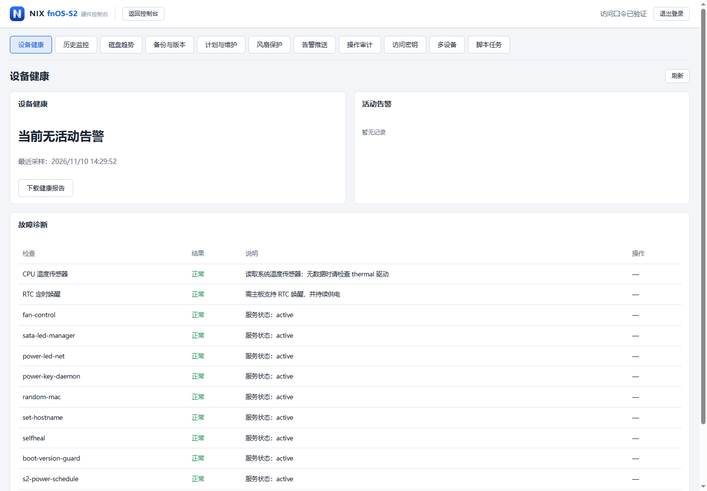
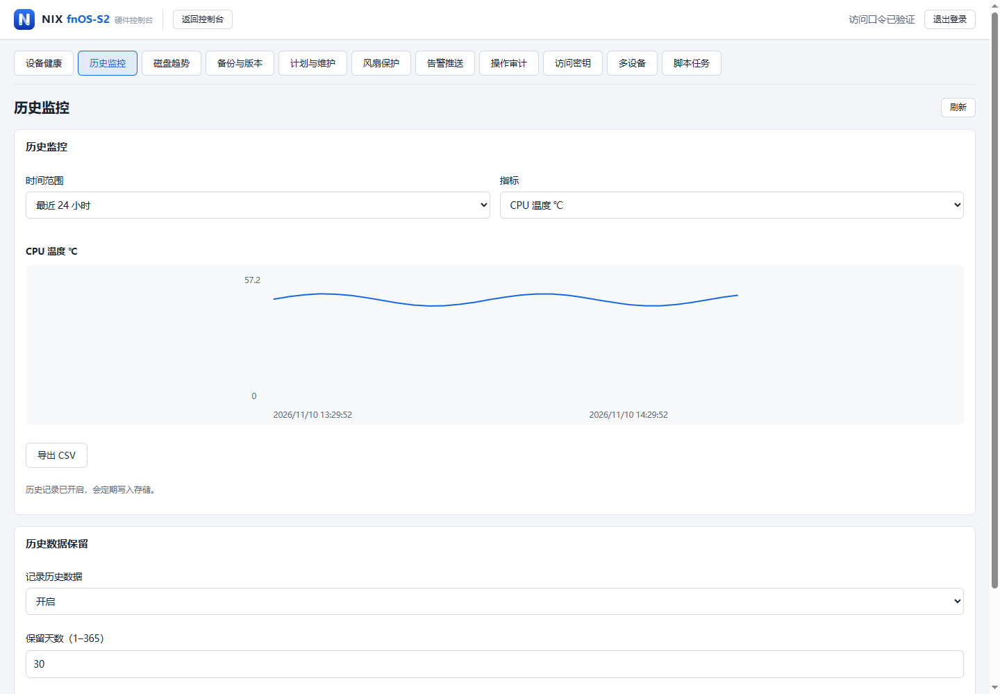
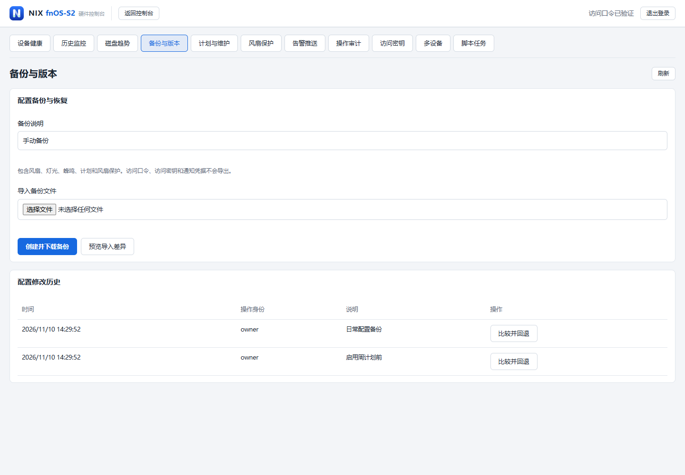
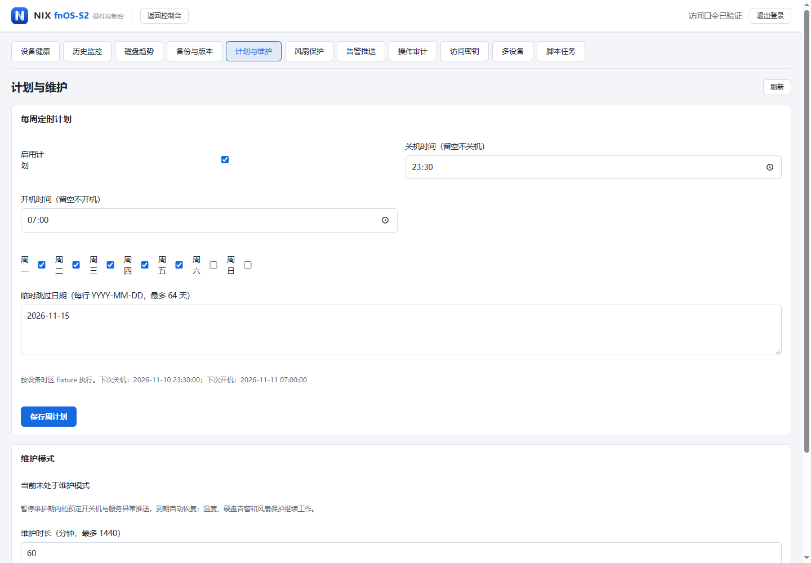
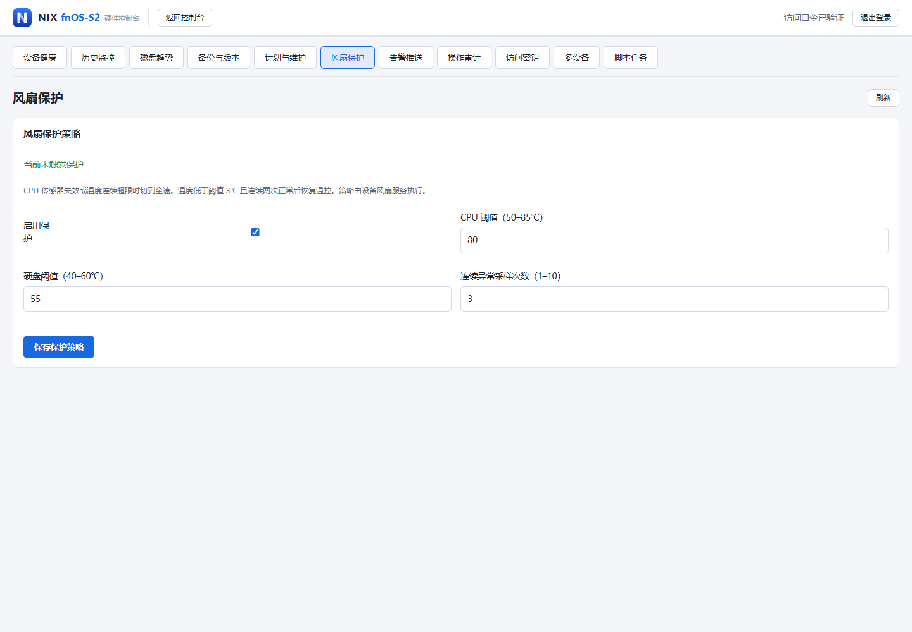
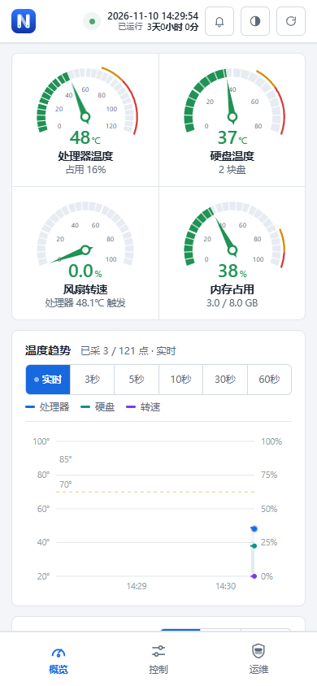
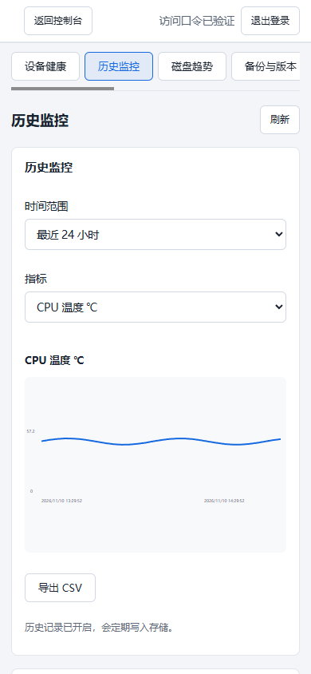

# fnOS-S2 硬件控制台

由 NIX 独立开发，面向飞牛 fnOS / RK3568 NAS 的硬件控制与运维工具。在网页中管理风扇、指示灯、蜂鸣器和定时开关机，并查看历史监控、备份与告警。

**当前版本：1.0.2** · [下载安装包](https://github.com/Ydd535365042/fnOS-S2hwd/releases/tag/v1.0.2) · [功能说明](docs/operations.md) · [更新记录](releases/notes-1.0.2.md)

## 新功能从这里打开

**电脑：顶部导航 → 运维。手机：底部导航 → 运维。**

保留原控制台的卡片布局与主题。也可以直接访问 `http://设备地址:18899/manage.html`，再通过“返回控制台”回到硬件控制页面。


> 本页截图来自 1.0.2 的实际页面，使用演示数据，不代表设备实测结果。演示环境已开启历史记录。

## 运维功能



| 功能 | 可以做什么 |
| --- | --- |
| 硬件控制 | 风扇曲线与保护策略、指示灯、蜂鸣器、服务状态和维护脚本 |
| 历史监控 | CPU、内存、温度、风扇趋势，保留期限、CSV 导出和 SMART 历史 |
| 备份与版本 | 配置备份、导入、差异预览、确认恢复和版本回退 |
| 计划与维护 | 按星期定时开关机、跳过日期、下次执行预览、限时维护模式 |
| 告警与诊断 | 设备诊断、健康报告、邮件 / Webhook 推送、操作审计 |
| 自动化 | 可限制权限和撤销的 API 密钥、多设备只读状态汇总、脚本审查及任务管理 |

### 历史监控

历史记录默认关闭，以减少后台写盘。需要时，在 **运维 → 历史监控 → 历史数据保留** 中开启；关闭后保留已有记录。可将运维数据目录配置在 SSD / eMMC 上。



<details>
<summary>查看配置备份、周计划和风扇保护</summary>

### 配置备份与版本

恢复前先查看差异并确认，恢复时自动保留修改前的配置。



### 周计划与维护模式



### 风扇保护



</details>

### 手机端

<p>
  
  
</p>

## 安装与登录

1. 从 [v1.0.2 发布页](https://github.com/Ydd535365042/fnOS-S2hwd/releases/tag/v1.0.2) 下载 `fnOS-S2-v1.0.2.fpk`，可用随附的 `.sha256` 文件校验。
2. 在飞牛 fnOS 应用中心手动安装或升级。已有本应用时保留原应用数据进行升级。
3. 默认端口为 `18899`，端口和访问口令可在安装向导或应用设置中修改。
4. 打开控制台，只输入访问口令即可登录；点击“运维”进入新功能。

**没有账号系统。** 登录记忆无固定有效期，关闭浏览器或重启应用后仍保留。主动退出、修改口令或清除本站浏览器数据后需要重新登录。

未设置访问口令时，远程访问只读，硬件控制和脚本执行仅允许在设备本机操作。避免同时运行争用相同端口、风扇或指示灯的控制程序。

<details>
<summary>查看仅口令登录页面</summary>


</details>

## 1.0.2 的重点修复

- 补齐桌面和手机的“运维”入口，解决新功能已有实现但首页找不到入口的问题。
- 移除账号登录、账号管理与角色逻辑，恢复仅访问口令登录，并持久保存登录记忆。
- 移除 drivetemp 取温与主动加载；休眠或电源状态未知时跳过相关采集。
- 修复风扇服务启动依赖，统一安装、升级、自愈的模块禁用迁移。
- 历史记录改为手动开启；无新通知时不重复写入游标。

详见 [硬盘休眠修复说明](docs/disk-sleep-fixes-2026-11-10.md) 和 [安全修复记录](docs/security-fixes-2026-11-10.md)。

## 兼容性与验证

- 飞牛 fnOS ≥ 0.9.0，arm64；面向 RK3568 NAS（双 SATA 盘位 + eMMC）。
- 后端测试 63 项通过，1 项 Linux 权限检查因 Windows 环境跳过；Chrome 浏览器检查 122 项通过。
- 覆盖 7 种屏幕宽度的运维入口、仅口令登录、登录记忆、权限边界和主要功能流程。
- 真实 NAS 安装升级、冷启动、物理风扇、硬盘休眠 / RTC 唤醒和外部通知投递仍需实机验证。

## 从源码构建

```powershell
python -I -B build_fpk.py app fpk releases/fnOS-S2-v1.0.2.fpk 1.0.2 releases/changelog-1.0.2.txt
```

README 截图可通过 `node tests/capture_readme.mjs` 重新生成，需要本机 Chrome 和 Python。演示环境只监听回环地址，不执行真实硬件操作。

## 许可

MIT，见 [LICENSE](fpk/LICENSE)。
