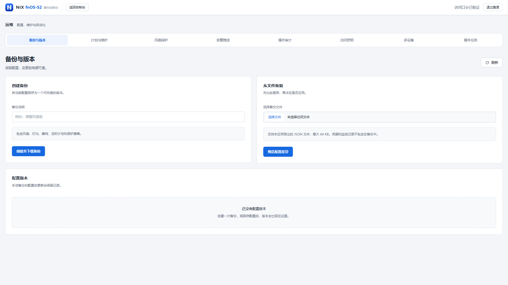

# fnOS-S2 硬件控制台

由 NIX 独立开发，面向飞牛 fnOS / RK3568 NAS 的硬件控制与运维工具。在网页中管理风扇、指示灯、蜂鸣器和定时开关机，并管理配置备份、维护计划与告警。

**当前版本：1.0.5** · [下载安装包](https://github.com/Ydd535365042/fnOS-S2hwd/releases/tag/v1.0.5) · [功能说明](docs/operations.md) · [更新记录](releases/notes-1.0.5.md)

1.0.5 提供全宽运维界面与八项功能，沿用原生硬件控制、DTB 审查升级与回滚、电源灯美化。操作统一在 **控制 → 脚本库**，详见 [使用说明](docs/native-hardware.md)。

## 新功能从这里打开

**电脑：顶部导航 → 运维。手机：底部导航 → 运维。**

保留原控制台的卡片布局与主题。也可以直接访问 `http://设备地址:18899/manage.html`，再通过“返回控制台”回到硬件控制页面。


> 截图使用演示数据，不代表设备实测结果；控制台首页沿用原布局。

## 运维功能

运维只保留以下八项，默认进入“备份与版本”。设备健康、历史监控和磁盘趋势页面已移除。



<details><summary>查看手机运维与脚本确认弹窗</summary>

<p></p>

</details>

| 功能 | 可以做什么 |
| --- | --- |
| 备份与版本 | 创建和下载配置备份、导入差异预览、确认恢复与版本回退 |
| 计划与维护 | 执行星期、跳过日期、下次执行预览、临时维护 |
| 风扇保护 | CPU / 硬盘温度阈值与连续异常采样保护 |
| 告警推送 | Webhook 或邮件渠道、投递状态 |
| 操作审计 | 按身份与动作查询，分页查看并导出 CSV |
| 访问密钥 | 按用途授权、创建时复制密钥、确认撤销 |
| 多设备 | 只读状态汇总、登记设备和确认移除 |
| 脚本任务 | 查看任务结果与日志、确认取消运行中的任务 |

开关机时间与总开关统一在概览页设置，风扇曲线、脚本管理与执行统一在控制页。运维不重复提供这些编辑入口。桌面和手机共用这八项导航，列表在手机端按记录分行展示。

脚本执行确认弹窗先展示操作影响，脚本内容、差异和校验摘要可展开查看；系统改动仍需输入 `yes`，确认后才执行当前版本。

## 安装与登录

1. 从 [v1.0.5 发布页](https://github.com/Ydd535365042/fnOS-S2hwd/releases/tag/v1.0.5) 下载 `fnOS-S2-v1.0.5.fpk`，可用随附的 `.sha256` 文件校验。
2. 在飞牛 fnOS 应用中心手动安装或升级。已有本应用时保留原应用数据进行升级。
3. 默认端口为 `18899`，端口和访问口令可在安装向导或应用设置中修改。
4. 打开控制台，只输入访问口令即可登录；点击“运维”进入新功能。

**没有账号系统。** 登录记忆无固定有效期，关闭浏览器或重启应用后仍保留。主动退出、修改口令或清除本站浏览器数据后需要重新登录。

未设置访问口令时，远程访问只读，硬件控制和脚本执行仅允许在设备本机操作。避免同时运行争用相同端口、风扇或指示灯的控制程序。

<details>
<summary>查看仅口令登录页面</summary>


</details>

## 1.0.5 更新

- 计划应用失败时恢复原配置，并反馈系统服务的恢复结果。
- 修复多设备增删时旧缓存回流，隔离远端设备的异常响应。
- 防止并发告警重复投递，补齐邮件字段原始换行校验。
- 脚本启动失败持久留存；任务记录写入失败时不执行脚本。
- 全面核验八项运维的权限、数据读写、并发、失败恢复和 Chrome / Edge 交互。

详见 [1.0.5 更新记录](releases/notes-1.0.5.md) 和 [原生硬件使用说明](docs/native-hardware.md)。

## 兼容性与验证

- 飞牛 fnOS ≥ 0.9.0，arm64；面向 RK3568 NAS（双 SATA 盘位 + eMMC）。
- Chrome 浏览器交互检查 147 项通过；模拟硬件，使用真实应用路由和临时数据库验证主要读写流程。
- 当前后端检查 78 项通过，1 项 POSIX 权限检查因 Windows 环境跳过。
- Chrome 和 Edge 各 41 项深入联调通过，包含真实 HTTP / SQLite 与无害脚本监督进程；外部服务与硬件使用模拟边界。
- 八项运维在 360、390、768、1440、1920、2560px 下共 48 组全宽布局检查通过。
- 真实 NAS 安装升级、DTB 刷写与重启、物理风扇与灯光、硬盘休眠 / RTC 唤醒和外部通知投递仍需实机验证。

## 从源码构建

```powershell
python -I -B build_fpk.py app fpk releases/fnOS-S2-v1.0.5.fpk 1.0.5 releases/changelog-1.0.5.txt
```

## 许可

MIT，见 [LICENSE](fpk/LICENSE)。
