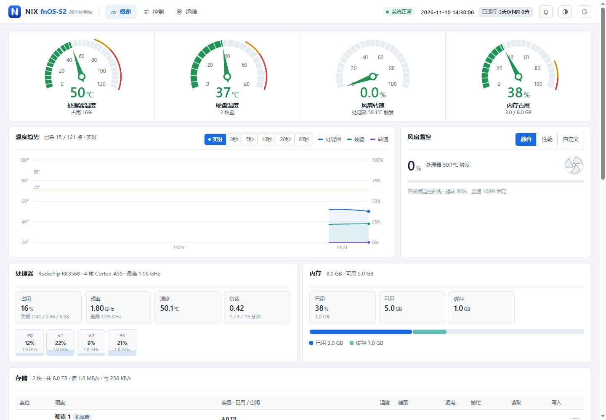

# fnOS-S2 硬件控制台

由 NIX 独立开发，面向飞牛 fnOS / RK3568 NAS 的硬件控制与运维工具。在网页中管理风扇、指示灯、蜂鸣器和定时开关机，并接收告警与邮件通知。

**当前版本：1.0.7** · [下载安装包](https://github.com/Ydd535365042/fnOS-S2hwd/releases/tag/v1.0.7) · [通知说明](docs/notifications.md) · [更新记录](releases/notes-1.0.7.md)

1.0.7 恢复脚本库默认脚本，新增风扇滑动调速和 SSL 邮件通知，并修复界面迟钝与状态不一致。硬件维护统一在 **控制 → 脚本库 / 已安装模块**，邮件 / Webhook 设置在铃铛菜单中打开。

## 新功能从这里打开

**电脑和手机：顶部导航 → 控制。告警通知：右上角铃铛 → 邮件 / 推送设置。**

保留原控制台的卡片布局与主题。直接打开 `http://设备地址:18899/` 进入控制台。



> 截图使用演示数据，不代表设备实测结果；控制台首页沿用原布局。

## 告警通知

告警记录继续显示在控制台右上角铃铛中。点击“邮件 / 推送设置”可保存 Webhook 或邮件（SSL / STARTTLS）配置，用当前填写的内容发送测试通知并查看投递结果和失败原因。凭据沿用应用已有私有数据目录，接口不会返回完整密钥。

## 脚本库与模块

**控制 → 脚本库** 自带六个默认脚本：硬件自检、收集诊断信息、升级 S2 设备树、安装 / 停用电源灯美化、回滚上次 DTB 升级。点「运行」会先展示脚本内容和影响，确认后执行，输出实时显示在执行日志，可随时「停止」。误删后点「恢复默认脚本」补回；也可以拖入自己的 `.sh` 脚本或 `.run` 安装包。

设备树、自愈和电源灯美化同时作为完整包模块显示在 **控制 → 已安装模块**。安装前会校验原包，执行失败不会标记成功。电源灯美化请只用脚本或模块其中一种。

## 安装与登录

1. 从 [v1.0.7 发布页](https://github.com/Ydd535365042/fnOS-S2hwd/releases/tag/v1.0.7) 下载 `fnOS-S2-v1.0.7.fpk`，可用随附的 `.sha256` 文件校验。
2. 在飞牛 fnOS 应用中心手动安装或升级。已有本应用时保留原应用数据进行升级。
3. 默认端口为 `18899`，端口和访问口令可在安装向导或应用设置中修改。
4. 打开控制台，只输入访问口令即可登录；硬件和模块操作进入“控制”，通知设置点击右上角铃铛。

**没有账号系统。** 登录记忆无固定有效期，关闭浏览器或重启应用后仍保留。主动退出、修改口令或清除本站浏览器数据后需要重新登录。

未设置访问口令时，远程访问只读，硬件控制和脚本执行仅允许在设备本机操作。避免同时运行争用相同端口、风扇或指示灯的控制程序。

<details>
<summary>查看仅口令登录页面</summary>


</details>

## 1.0.7 更新

- 脚本库恢复六个默认脚本，新增「恢复默认脚本」、运行中「停止」和页面重开后接回任务。
- 风扇卡新增 30–100% 滑动手动调速，显示两路温度与需求转速；超温和全速点仍自动全速。
- 邮件通知支持 SSL（465）与 STARTTLS（587），测试使用当前填写内容并给出具体失败原因。
- 修复状态刷新被慢操作阻塞、写操作后按钮回跳、多页面同时打开时读数跳动等问题。
- 移除旧运维中心遗留的配置备份 / 恢复、维护窗口和风扇保护接口。

完整列表见 [更新记录](releases/notes-1.0.7.md)，硬件说明见 [原生硬件说明](docs/native-hardware.md)。

## 兼容性与验证

- 飞牛 fnOS ≥ 0.9.0，arm64；面向 RK3568 NAS（双 SATA 盘位 + eMMC）。
- 1.0.7 在开发机上用模拟硬件验证：风扇卡 14 项、控制页与通知页 9 项浏览器检查通过，邮件通知 16 项、脚本迁移和既有后端接口 6 项检查通过；桌面与手机共 14 个视口无脚本错误和横向溢出。
- 真实 NAS 上的安装升级、风扇手动调速、DTB 刷写与重启、灯光、硬盘休眠 / RTC 唤醒和外部邮件投递尚未实机验证。

## 从源码构建

```powershell
python -I -B build_fpk.py app fpk releases/fnOS-S2-v1.0.7.fpk 1.0.7 releases/changelog-1.0.7.txt
```

## 许可

MIT，见 [LICENSE](fpk/LICENSE)。
