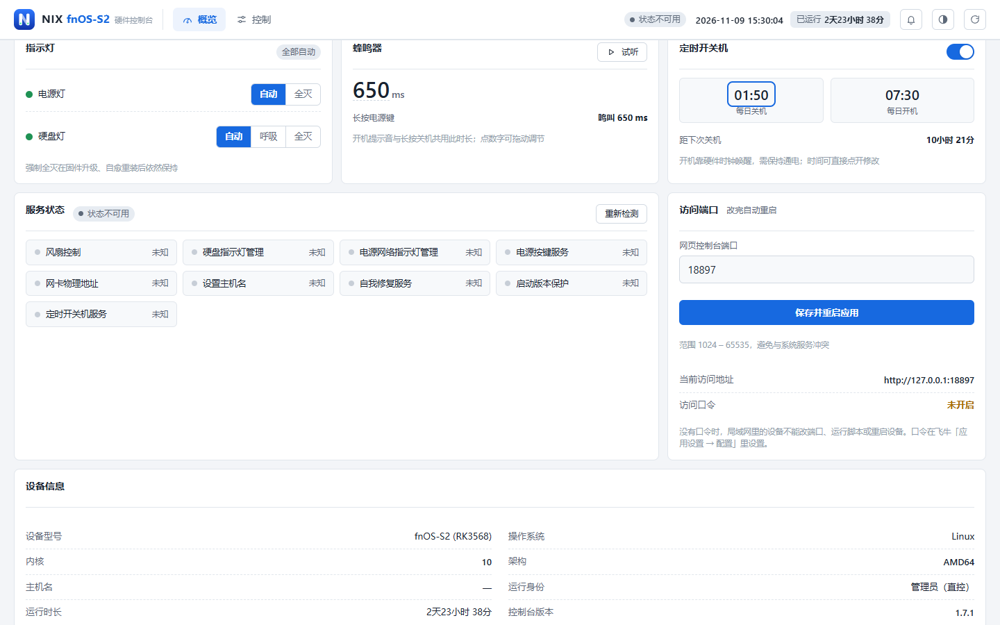
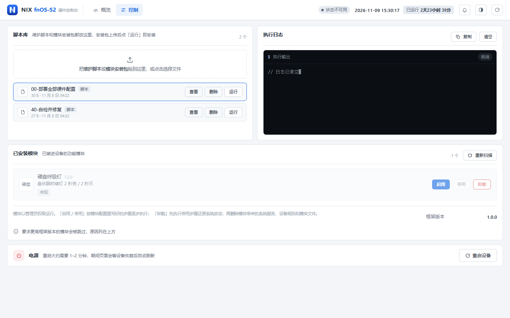
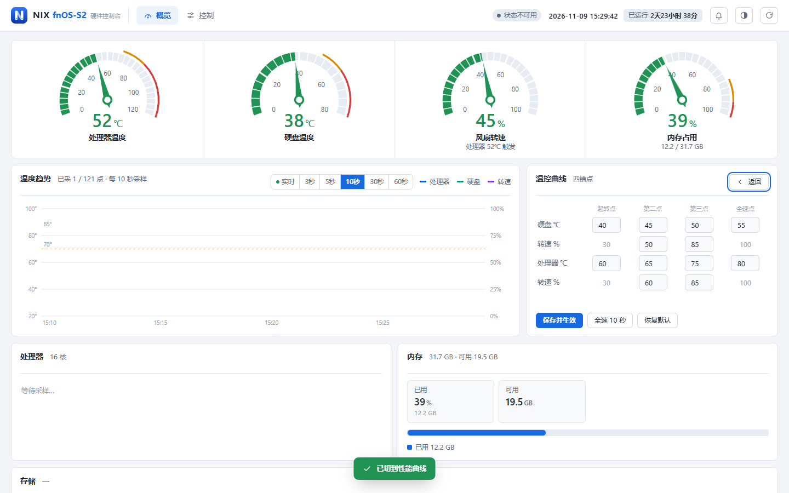
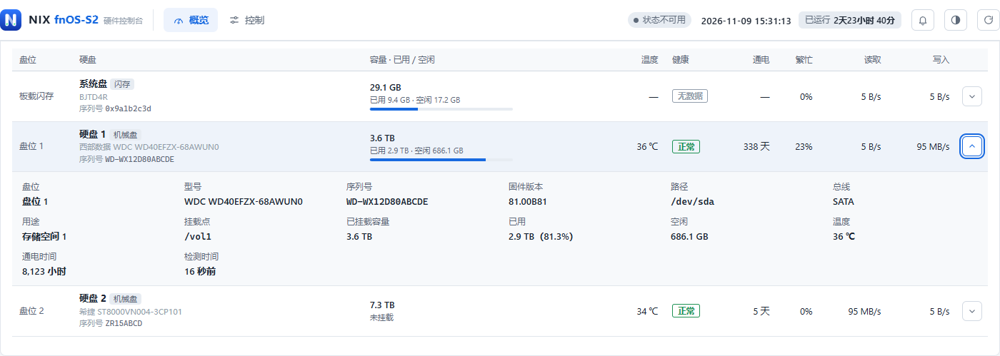
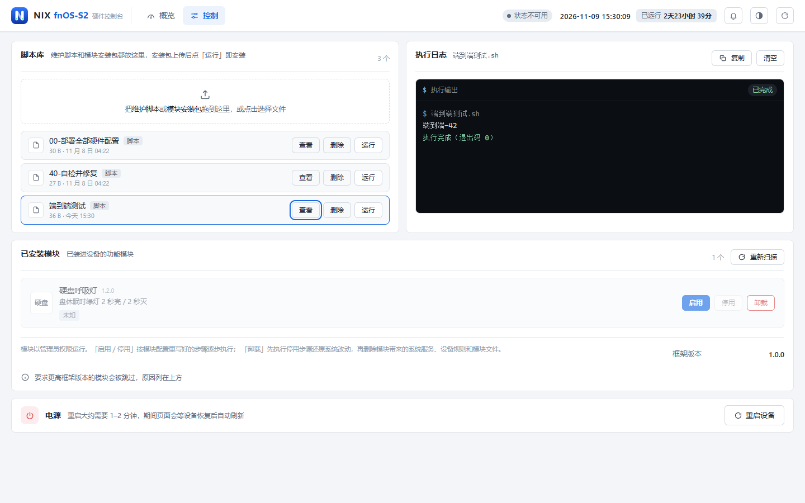
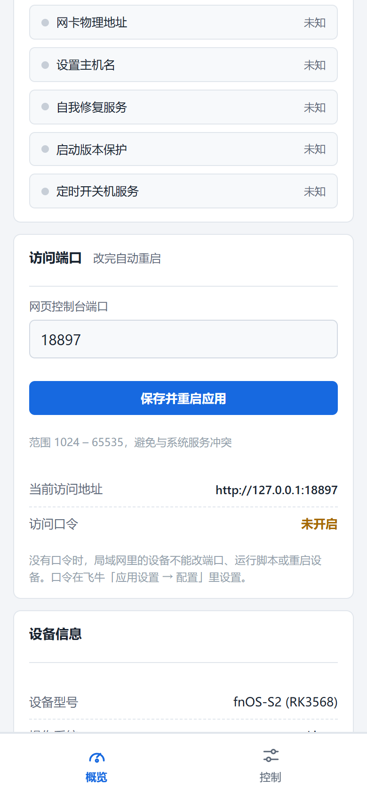
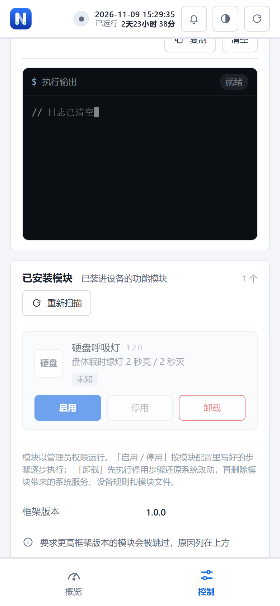
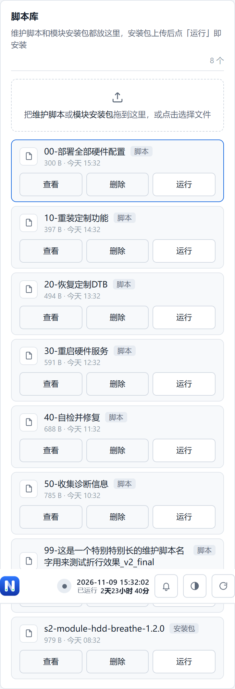

# fnOS-S2 硬件控制台

由 NIX 独立开发，飞牛 fnOS 上的硬件控制台：电源灯、硬盘灯、风扇、蜂鸣器、定时开关机，网页上直接调，不用 SSH。


## 界面











手机端：

  

## 安装

从 [Releases](../../releases) 下载 `fnOS-S2-v1.0.1.fpk`，在飞牛 fnOS 应用中心选择「手动安装」上传。

设备上如果装过同类的硬件控制应用，请先卸载再装本应用，避免抢占 18899 端口与同一套风扇 / 灯光硬件。

默认端口 `18899`，可在向导与设置中改；建议设个访问口令。

设置口令后在登录页输入，登录状态仅保存在当前标签页，最长 12 小时；退出登录、
会话过期或应用重启后需要重新登录。旧版 Cookie 与 `?token=` 链接不再用于认证。
未设置口令时，远程设备可查看状态，硬件控制、脚本执行和配置修改仅允许本机操作。

安全修复范围、验证结果及接口迁移说明见 [安全修复记录](docs/security-fixes-2026-11-10.md)。

1.0.1 增加 15 项运维功能，使用方法和验证边界见 [运维功能说明](docs/operations.md)。
原控制台布局保持不变；新功能在相同地址的 `/manage.html` 页面，沿用原界面主题。
自动化测试已通过；真实 NAS 安装、物理风扇、RTC 唤醒和外部通知投递尚未完成实机验证。

2026-11-10 更新的 v1.0.1 已包含[硬盘休眠修复](docs/disk-sleep-fixes-2026-11-10.md)，
涵盖温度采集、启动依赖、升级迁移与历史记录写盘控制。版本号保持 1.0.1，请重新下载最新附件并核对随附 SHA256。

## 构建

```
python -I build_fpk.py <app目录> <fpk目录> <输出.fpk> <版本号> <changelog文本>
```

## 兼容性

- 飞牛 fnOS ≥ 0.9.0（arm64）
- RK3568 NAS 主机（双 SATA 盘位 + eMMC）

## 许可

MIT，见 [LICENSE](fpk/LICENSE)。
