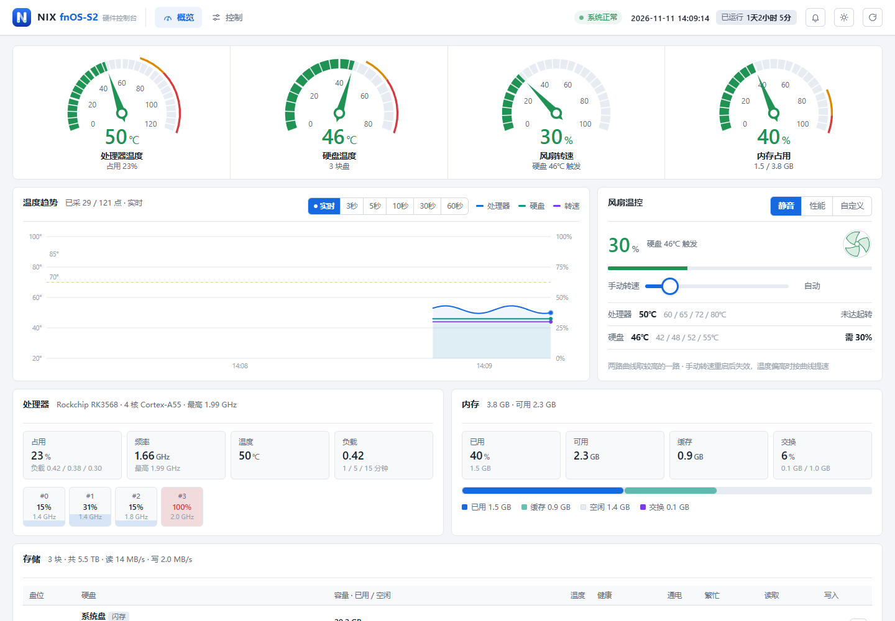
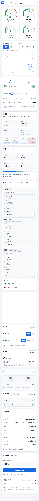
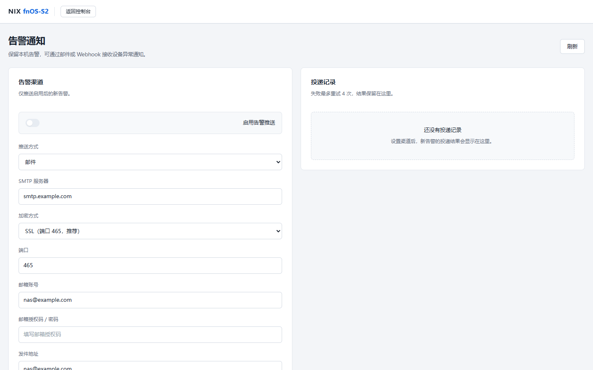
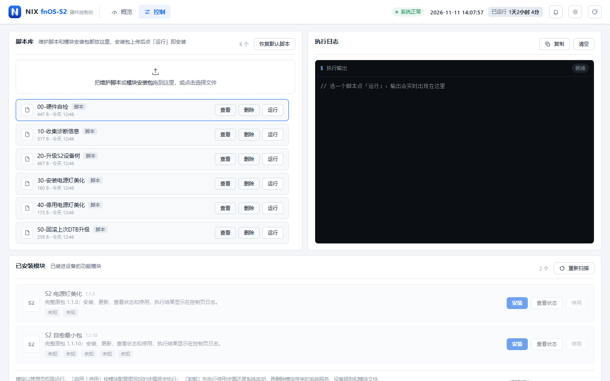

# fnOS-S2 硬件控制台

由 NIX 独立开发，面向飞牛 fnOS / RK3568 NAS 的硬件控制与运维工具。在网页中管理风扇、指示灯、蜂鸣器和定时开关机，并接收告警与邮件通知。

**当前版本：1.1.6** · [下载安装包](https://github.com/Ydd535365042/fnOS-S2hwd/releases/tag/v1.1.6) · [通知说明](docs/notifications.md) · [更新记录](releases/notes-1.1.6.md)

1.1.0 固定了风扇滑块的按钮、数字和轨道位置，定时开关机保存立即回应并带等待状态；1.0.9 让滑块边拖边生效、曲线四个点的转速全部可调，并收紧了布局。硬件维护统一在 **控制 → 脚本库 / 已安装模块**，邮件 / Webhook 设置在铃铛菜单中打开。

## 新功能从这里打开

**电脑和手机：顶部导航 → 控制。告警通知：右上角铃铛 → 邮件 / 推送设置。**

保留原控制台的卡片布局与主题。直接打开 `http://设备地址:18899/` 进入控制台。



> 截图使用演示数据，不代表设备实测结果。

<details>
<summary>查看手机端首页</summary>



</details>

## 告警通知

告警记录继续显示在控制台右上角铃铛中。点击“邮件 / 推送设置”可保存 Webhook 或邮件（SSL / STARTTLS）配置，用当前填写的内容发送测试通知并查看投递结果和失败原因。凭据沿用应用已有私有数据目录，接口不会返回完整密钥。



## 脚本库与模块

**控制 → 脚本库** 自带六个默认脚本：硬件自检、收集诊断信息、升级 S2 设备树、安装 / 停用电源灯美化、回滚上次 DTB 升级。点「运行」会先展示脚本内容和影响，确认后执行，输出实时显示在执行日志，可随时「停止」。误删后点「恢复默认脚本」补回；也可以拖入自己的 `.sh` 脚本或 `.run` 安装包。

设备树、自愈和电源灯美化同时作为完整包模块显示在 **控制 → 已安装模块**。安装前会校验原包，执行失败不会标记成功。电源灯美化请只用脚本或模块其中一种。



## 安装与登录

1. 从 [v1.1.6 发布页](https://github.com/Ydd535365042/fnOS-S2hwd/releases/tag/v1.1.6) 下载 `fnOS-S2-v1.1.6.fpk`，可用随附的 `.sha256` 文件校验。
2. 在飞牛 fnOS 应用中心手动安装或升级。已有本应用时保留原应用数据进行升级。
3. 默认端口为 `18899`，端口和访问口令可在安装向导或应用设置中修改。
4. 打开控制台，只输入访问口令即可登录；硬件和模块操作进入“控制”，通知设置点击右上角铃铛。

**没有账号系统。** 登录记忆无固定有效期，关闭浏览器或重启应用后仍保留。主动退出、修改口令或清除本站浏览器数据后需要重新登录。

未设置访问口令时，远程访问只读，硬件控制和脚本执行仅允许在设备本机操作。避免同时运行争用相同端口、风扇或指示灯的控制程序。

<details>
<summary>查看仅口令登录页面</summary>


</details>

## 1.1.6 更新

- 修复硬盘没到起转温度风扇却一直转：CPU 短暂升温起转后，降温回差被错误地套在硬盘上（硬盘停在 40–41℃ 时风扇被锁在 30%）。现在 CPU、硬盘各自计算回差。
- 电源灯美化的开机 / 关机指示服务显示「开关机时运行」，不再标「未运行」。

## 1.1.5 更新

- 打开概览页时卡片不再整体往下跳（顶部仪表盘从第一帧就占好位置）。
- 风扇控制器后台 CPU 占用降低约四成：静态的传感器和指示灯目录改为缓存，每 60 秒重扫一次。
- 定时开关机开关在手机上更容易点中，键盘操作时显示焦点框。

## 1.1.4 更新

- 修复定时开关机失效：自愈包守护会删除所有 `s2-*.sh` 脚本，定时脚本已改名并移到应用自己的目录 `/usr/local/lib/fnos-s2/`。
- 已安装模块分成「已安装」和「可安装的内置包」，卸载后移到可安装；显示设备上实际装的版本，更新后版本号随之变化。
- 自愈包「查看状态」不再因超时失败；登录页口令框聚焦时不再出现双边框。
- 硬件时钟不支持唤醒时只提示定时开机不可用，定时关机照常生效。

## 1.1.3 更新

- 修复手机经飞牛 App / 远程访问输入口令后提示「请求来源不受信任」进不去。
- 修复温度未到起转点时风扇仍以起转转速运转（启动自检、全速测试、手动调速之后误触发降温回差）。
- 修复定时关机在升级应用后失效，以及定时器稍晚触发时当天不关机；网页打开定时后开机闹钟重设完整。
- 内置模块安装、更新、停用、卸载改为后台任务，执行日志实时输出，结束后列表自动更新；恢复卸载按钮。

## 1.1.2 更新

- 风扇自动时手动滑块停在 0、显示 0%；拖动进入手动，范围 30–100%；恢复自动后滑块回到 0。

## 1.1.1 更新

- 风扇手动和自动分开显示：自动时按钮显示「自动」、滑块不跟着实际转速移动；拖动后按钮变「恢复自动」并显示百分比。
- 点「恢复自动」立即切换，读数直接显示控制器将给出的自动转速；修复拖动后偶尔要等 2 秒才生效。

## 1.1.0 更新

- 风扇滑块：「恢复自动」按钮始终显示在固定位置，轨道刻度固定 0–100%、最低可设 30%，百分比只在滑块右侧一处显示。
- 定时开关机：保存立即回应，系统服务在后台应用；应用期间开关旁显示「正在应用…」，失败自动退回并提示。
- 温控曲线起转转速下限改回 30%；趋势图悬浮提示的温度显示整数。

## 1.0.9 更新

- 风扇滑块：拖动时布局不再变化（不抖），边拖边生效，步进 1%。
- 温控曲线：起转点和全速点的转速也可以改，四个点全部可调；新增硬盘 60℃ 强制全速保护。
- 定时开关机：开关和改时间立刻反映到界面，连续操作合并保存；计划没变时不再重载系统服务。
- 布局：概览底部服务状态与设备信息叠成左栏；控制页脚本库与执行日志等高，列表和日志在框内滚动。

## 1.0.8 更新

- 修复「全速 10 秒」看起来没反应：测试时翻回卡片正面并每秒刷新读数；控制台早于风扇驱动启动时不再把指令写到旧控制器的目录。
- 风扇指令约 0.25 秒内响应；手动转速在温度升到曲线第三点后按曲线提速。
- 页面资源压缩传输，首次打开的下载量约为原来的三分之一。
- 修复服务状态缓存过期、脚本任务接回和停止的若干问题。

## 1.0.7 更新

- 脚本库恢复六个默认脚本，新增「恢复默认脚本」、运行中「停止」和页面重开后接回任务。
- 风扇卡新增 30–100% 滑动手动调速，显示两路温度与需求转速；超温和全速点仍自动全速。
- 邮件通知支持 SSL（465）与 STARTTLS（587），测试使用当前填写内容并给出具体失败原因。
- 修复状态刷新被慢操作阻塞、写操作后按钮回跳、多页面同时打开时读数跳动等问题。
- 移除旧运维中心遗留的配置备份 / 恢复、维护窗口和风扇保护接口。

完整列表见 [1.1.6](releases/notes-1.1.6.md)、[1.1.5](releases/notes-1.1.5.md)、[1.1.4](releases/notes-1.1.4.md)、[1.1.3](releases/notes-1.1.3.md)、[1.1.2](releases/notes-1.1.2.md)、[1.1.1](releases/notes-1.1.1.md)、[1.1.0](releases/notes-1.1.0.md)、[1.0.9](releases/notes-1.0.9.md)、[1.0.8](releases/notes-1.0.8.md) 与 [1.0.7](releases/notes-1.0.7.md) 更新记录，硬件说明见 [原生硬件说明](docs/native-hardware.md)。

## 兼容性与验证

- 飞牛 fnOS ≥ 0.9.0，arm64；面向 RK3568 NAS（双 SATA 盘位 + eMMC）。
- 1.1.6 在实机上复现并验证了风扇回差修复（四核加负载使 CPU 升到 61℃ 起转，撤负载后硬盘 41℃ 时风扇停转），功能与浏览器测试全部通过，测试后配置与快照一致。
- 1.1.5 在实机上测量了接口耗时（5–35 毫秒）、页面加载与交互耗时（25 毫秒内）和风扇控制器 CPU；开发机全部回归检查通过。
- 1.1.4 在实机上安装测试了登录、状态读取、风扇手动与恢复自动、模块状态和定时开关机的打开与关闭，桌面和手机浏览器无脚本错误；测试后配置、定时器和 RTC 闹钟都与测试前一致。
- 1.1.3 在开发机上用模拟硬件验证：滑块、曲线、定时开关机和布局 42 项，风扇卡 14 项，全速测试真实点击 13 项，控制页与通知页 9 项浏览器检查通过；风扇控制与后端识别 24 项、定时计划后台应用 9 项、定时计划脚本 7 项、邮件通知 16 项、脚本迁移和既有后端接口 6 项检查通过；桌面与手机共 14 个视口无脚本错误和横向溢出。
- 真实 NAS 上的安装升级、风扇手动调速、DTB 刷写与重启、灯光、硬盘休眠 / RTC 唤醒和外部邮件投递尚未实机验证。

## 从源码构建

```powershell
python -I -B build_fpk.py app fpk releases/fnOS-S2-v1.1.6.fpk 1.1.6 releases/changelog-1.1.6.txt
```

## 许可

MIT，见 [LICENSE](fpk/LICENSE)。
